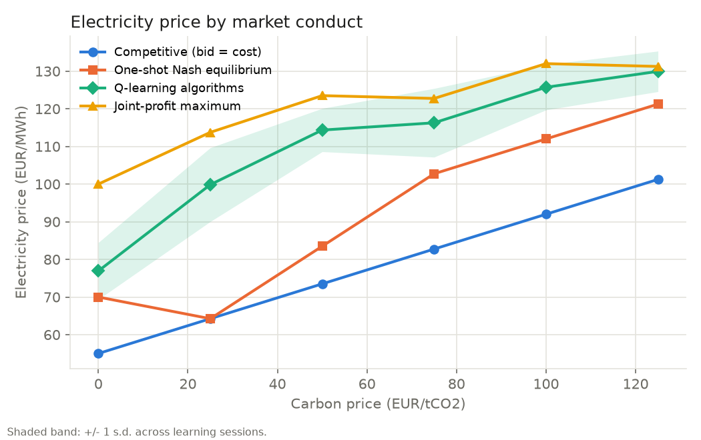
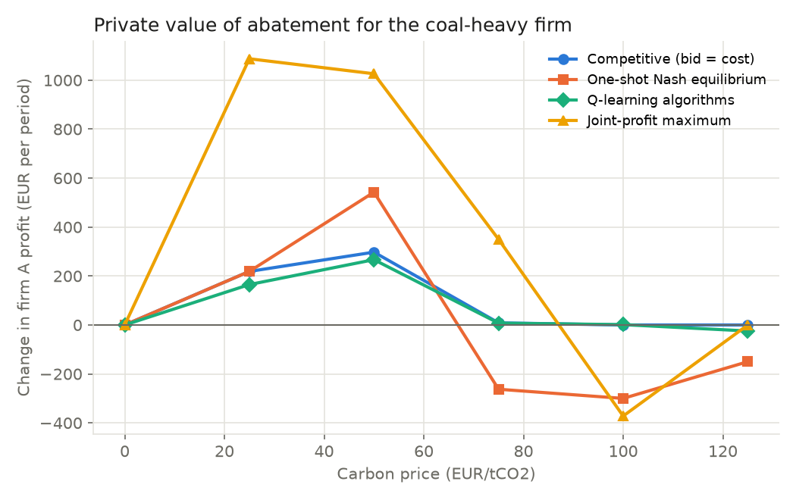

# Carbon prices, algorithmic bidding and the value of abatement

A small, fully reproducible simulation of an electricity spot market in which two
generators, each owning a coal unit and a gas unit, set their offer prices with
**independent Q-learning algorithms**. The model asks three questions:

1. How much of a **carbon price** passes through to the electricity price when
   firms bid competitively, strategically (one-shot Nash), as a cartel, or with
   learning algorithms?
2. Do learning algorithms, without communicating, learn to keep **prices above
   the Nash level** (tacit algorithmic collusion, as in Calvano et al., 2020)?
3. Is **abatement** (a cleaner coal unit) worth more or less to the firm that
   invests in it, depending on how the market sets prices?

The model is stylised and its parameters are illustrative. It is a tool for
thinking about mechanisms, not a calibrated forecast.



## Main results

Results are averaged over 20 independent learning sessions per carbon price.
All sessions converged.

| Carbon price (EUR/t) | 0 | 25 | 50 | 75 | 100 | 125 |
|---|---:|---:|---:|---:|---:|---:|
| Competitive price (EUR/MWh) | 55.0 | 64.2 | 73.5 | 82.8 | 92.0 | 101.2 |
| Nash equilibrium price | 70.0 | 64.2 | 83.5 | 102.8 | 112.0 | 121.2 |
| **Q-learning price** | **76.9** | **99.9** | **114.4** | **116.3** | **125.7** | **129.9** |
| Joint-profit-maximising price | 100.0 | 113.8 | 123.5 | 122.8 | 132.0 | 131.2 |
| Collusion index of learners (0 = Nash, 1 = cartel) | 0.33 | 0.79 | 0.83 | 0.42 | 0.64 | 0.55 |

* **Learning algorithms price above the Nash equilibrium at every carbon price**,
  recovering 33–83% of the gap between Nash and cartel profits.
* **Pass-through differs by conduct.** Moving from 0 to 125 EUR/t raises the
  competitive price by 0.37 EUR/MWh per EUR/t, but the cartel price by only
  0.25. A firm that already holds a high markup absorbs part of the cost shock.
  Learned prices start high at zero carbon price and stay close to the cartel
  price as carbon prices rise.
* **Higher prices mean lower emissions.** Because demand responds to price,
  algorithmic markups reduce output and therefore emissions (see
  `results/fig2_emissions.png`). This is an emissions reduction paid for by
  consumers through higher prices, not through cleaner production.
* **The private value of abatement depends on market conduct**
  (`results/fig3_abatement_value.png`).
  - At moderate carbon prices (25–50 EUR/t), abatement earns the coal-heavy
    firm less under algorithmic bidding than under competition.
  - In the one-shot game at high carbon prices, abatement can **lower** the
    investing firm's profit. Its cheaper coal unit removes the high-price
    equilibrium and the market becomes more competitive.
  - Abatement can also **raise** emissions at intermediate carbon prices,
    because a cleaner coal unit moves back ahead of gas in the merit order.



## How it works

| File | What it does |
|---|---|
| `src/carbonbid/market.py` | Market primitives and the market-clearing algorithm |
| `src/carbonbid/lp_clearing.py` | The same clearing as a welfare-maximising **linear programme** (SciPy/HiGHS); the price is the dual of the energy-balance constraint |
| `src/carbonbid/game.py` | Payoff tables, pure-strategy **Nash equilibria**, joint-profit maximum, collusion index |
| `src/carbonbid/qlearning.py` | Independent **Q-learning** bidders, vectorised over sessions with NumPy |
| `experiments/run_experiments.py` | Carbon-price sweep × {baseline, abated} → `results/results.csv` |
| `experiments/make_figures.py` | Figures in `results/` |
| `tests/test_market.py` | Automated checks (market balance, LP vs. algorithm, Nash on a known game, …) |
| `docs/walkthrough.md` | Step-by-step explanation of the model and the code |

## Reproduce

```bash
pip install -r requirements.txt
python -m pytest                      # about 5 seconds
python experiments/run_experiments.py # about 13 minutes on a laptop
python experiments/make_figures.py
```

## Limitations and next steps

* The market has a single period, with no hours, block bids or storage. The
  next step is a 24-hour market with a battery: a price-taking battery is a
  linear programme, while a large battery that moves prices is a game.
* Parameters are illustrative, not calibrated. They could be calibrated to
  ENTSO-E data.
* Tabular Q-learning on a coarse grid of 15 markups. Results depend on
  learning parameters, which a full study would vary.

## References

* Calvano, E., Calzolari, G., Denicolò, V., and Pastorello, S. (2020).
  Artificial Intelligence, Algorithmic Pricing, and Collusion.
  *American Economic Review*, 110(10), 3267–3297.
* Sutton, R. S., and Barto, A. G. (2018). *Reinforcement Learning: An Introduction*. MIT Press.

## Author

Saeed Samadiye. I should mention that the code is revised by AI especially the Learning algorithm part. the backbone and foundation of game theory is completely developed by myself.
